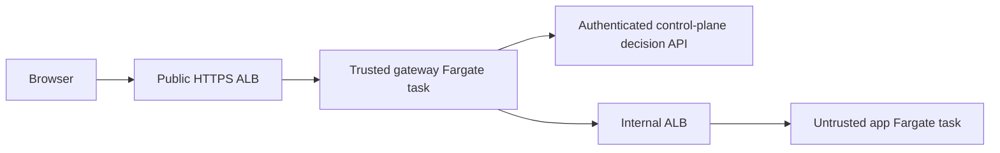

# AWS private application gateway

The load-balancer architecture below is historical design research. Current
regional fixed costs exceed the user's subsequently approved $10 additional
on-demand pilot budget. See [AWS_ON_DEMAND_PILOT_PLAN.md](./AWS_ON_DEMAND_PILOT_PLAN.md)
for the current candidate, live read-only inventory and cost/security gates.
The existing domain and DynamoDB/S3 choices are now resolved; no new domain
purchase or platform identity migration is planned.

Status: proposed implementation design; no runtime routing, security group, IAM,
domain, or production configuration has been changed by this document.

## Current code boundary

The ECS path currently builds a shared ALB, permits that ALB to reach application
security groups on the application port, and installs a host rule targeting the
application target group. See `src/lib/aws/ecsRailpackDeploy.ts` and
`src/lib/aws/awsHelpers.ts`. The app/workspace/use-grant increments add control
plane metadata and policy lookups; they do not protect these existing URLs.
This assessment concerns source code, not a live AWS configuration audit.

## Proposed first private runtime

Use a separate trusted gateway service on ECS Fargate, with its own task role,
secrets, and security group. Untrusted application code runs in different Fargate
tasks and never receives platform database, session-signing, or gateway-service
credentials.

An internal ALB is the preferred stable application routing boundary for the
first implementation. It accepts only the gateway security group; app security
groups accept only the internal routing tier on their declared port. The public
ALB may reach the gateway, never private-app targets. Dedicated private-app
security groups must not retain existing public-ALB, broad CIDR, or self-ingress
rules that bypass this chain.

AWS documents task ENIs and task security groups for Fargate's awsvpc networking.
Our proposed security-group chain follows that mechanism; it is an application
design, not a guarantee supplied by choosing Fargate alone.
[AWS ECS network security](https://docs.aws.amazon.com/AmazonECS/latest/developerguide/security-network.html).

AWS recommends restricting targets to their load balancer's security group.
Apply that principle separately to the public gateway tier and private app tier;
the existing public-ALB-to-app rule cannot remain on a private application.
[AWS ALB target security groups](https://docs.aws.amazon.com/elasticloadbalancing/latest/application/load-balancer-update-security-groups.html).

Keep gateway and application task roles distinct. AWS task-role permissions are
available to containers within that task, so a privileged gateway sidecar sharing
an untrusted app task is outside this design. Execution roles and app task roles
also remain separate and scoped to the images, logs, secrets, and app resources
they actually need.
[AWS ECS task IAM roles](https://docs.aws.amazon.com/AmazonECS/latest/developerguide/task-iam-roles.html).

## Identity and browser boundary

Better Auth remains the platform identity provider. The gateway must not expect
the platform session cookie to be sent to an application hostname. Design an
authenticated handoff with one-time, short-lived authorization codes bound to the
app, exact callback origin, authenticated user, browser state, and gateway
identity. Redeem only through an authenticated gateway/control-plane channel.
The callback is a reserved gateway route and never reaches customer code.

Use a dedicated application domain isolated from the control-plane cookie
domain. The deployment domain and any domain purchase require an explicit
operator decision before live setup. This document does not authorize buying a
domain or sharing platform cookies across customer app subdomains.

Gateway sessions must be host-only, Secure, HttpOnly, application-bound cookies
with a protected cookie prefix. Strip gateway cookies and reserved identity
headers before proxying; reject upstream attempts to set gateway cookies or
parent-domain cookies. Never forward platform session tokens, gateway secrets,
or database credentials to application containers. Validate prefix support and
cookie handling across supported browsers; the prefix is defense in depth.
[MDN cookie scope and prefixes](https://developer.mozilla.org/en-US/docs/Web/HTTP/Reference/Headers/Set-Cookie).

Untrusted sibling apps must not be able to use another app's browser session:
enforce app-specific Origin checks for mutations and WebSockets, and a defined
Fetch Metadata/CORS/frame policy for private reads and subresources. Do not
delegate this boundary to arbitrary customer-supplied CORS headers. Cross-app
browser tests are an acceptance gate, not a configuration assumption. SameSite
alone does not separate sibling origins under one site.
[MDN CSRF and same-site boundaries](https://developer.mozilla.org/en-US/docs/Web/Security/Attacks/CSRF).

After authenticating, query the current app-use policy for the principal, then
resolve a server-owned runtime binding for that same app/release. Never accept a
user-supplied upstream URL, forwarded identity, target port, or host as the
authority for routing. Unknown hosts/apps and unavailable identity/policy
services fail closed. Supply verified identity to the application without
mapping workspace-management roles to application-specific business roles.
Fresh policy lookup must precede every HTTP authorization;
WebSockets require revalidation and connection closure on revocation, with the
maximum revocation delay explicitly defined and tested before release.

## Implementation slices

1. Control-plane handoff/session records and authenticated authorization API.
   Cover token replay, expiry, exact origin/app binding, identity spoofing,
   invalid sessions, lost verification, grant revocation, and membership removal.
2. Gateway HTTP/WebSocket runtime with streaming/backpressure, bounded request
   handling, header/cookie isolation, upstream allowlisting, and health endpoints.
   Use a local creator/member/outsider fixture before touching cloud resources.
3. Opt-in AWS infrastructure and deployment routing integration. Keep private
   apps on dedicated ingress/security groups and authoritative runtime bindings.
   Prove origins reject direct public access and traffic from other app tasks.
4. Publishing/sharing UI and a hosted pilot after explicitly authorized
   infrastructure, costs, domain configuration, and deployment. Do not label an
   app private until enforced runtime state and verification support that label.

For a public-to-private conversion, block the direct path before declaring
success. Failure must leave the app unavailable or private; a rollback must not
silently restore unauthenticated public access.

## Scope and unresolved operating choices

The first private gateway path targets container applications. Existing public
static S3/CloudFront URLs cannot become private merely by adding a gateway link.
Reject private publication for static apps until private storage/origin access
and authorization of all assets are implemented and verified.

Private subnet egress, NAT/endpoints, internal load balancing, gateway capacity,
TLS, logs, and database connections have cost/availability implications. Retrieve
current pricing and review a concrete infrastructure plan before provisioning;
no budget or default capacity is approved by this design. The existing control
plane hosting and Better Auth/Supabase services are not migrated here.

Untrusted builds also need app-scoped build/registry permissions and isolation
from platform credentials and networks. Runtime Fargate isolation does not by
itself establish a safe CodeBuild configuration.

Remaining implementation choices include authorization code/session lifetimes,
the connection revocation bound, a proxy library/protocol compatibility matrix,
an approved app domain, and the resource/cost envelope. Resolve security-relevant
ambiguity before enabling production behavior; do not hide it behind feature
flags or a successful metadata API test.

## Storage increment and remaining adapter boundary

[PR #94](https://github.com/anirudh-makuluri/smart-deploy/pull/94), stacked on the
app-use policy PR, adds the server-only handoff/session store and migration. It
requires explicit lifetimes (code at most 120 seconds, session at most one hour),
stores credential hashes, verifies S256 proof and exact callback/app binding,
consumes codes atomically, and permanently invalidates issued credentials when
authorization/identity/binding state changes. These caps are storage safeguards;
production configuration has not been chosen or enabled.

The browser adapter must still bind each login transaction/verifier/state, apply
Better Auth and platform approval/CSRF guards, and ensure the reserved callback
never reaches customer code. No origin routing or cookie/header enforcement is
supplied by the storage/API PRs. Their feature documentation records the adapter
contract, database-role prerequisites, and local/hosted verification boundary.

[PR #95](https://github.com/anirudh-makuluri/smart-deploy/pull/95) supplies the
default-off authenticated control-plane API using operator-owned machine keys
bound to a single registry binding. It checks fresh user/use/platform approval,
rejects supplied app/user/upstream authority, and bounds request bodies. This is
not the browser adapter, proxy, or origin enforcement.

[PR #96](https://github.com/anirudh-makuluri/smart-deploy/pull/96) implements the
confirmed policy that authenticated platform sign-out invalidates all of that
user's app sessions and pending handoffs. Credentials require a live originating
platform session, their expiry is capped at that login's expiry, and logout
removes credentials and the current platform session atomically before cookie
clearing. Other SmartDeploy logins remain signed in and may initiate fresh app
logins, but old app credentials cannot revive. Expired-session cleanup only
removes its linked credentials. Real Better Auth/database integration tests
cover success, rollback, and cleanup; this is not browser/proxy/WS proof.

[PR #97](https://github.com/anirudh-makuluri/smart-deploy/pull/97) adds the
default-off same-origin platform-browser handoff issuer with fresh Better Auth
and current database permission/session checks. Its state echo is correlation
data, not browser transaction proof. The confirmation UI and trusted gateway
transaction/state/cookie handling remain required before enablement; it supplies
no proxy, private AWS origin, or protected runtime proof.
